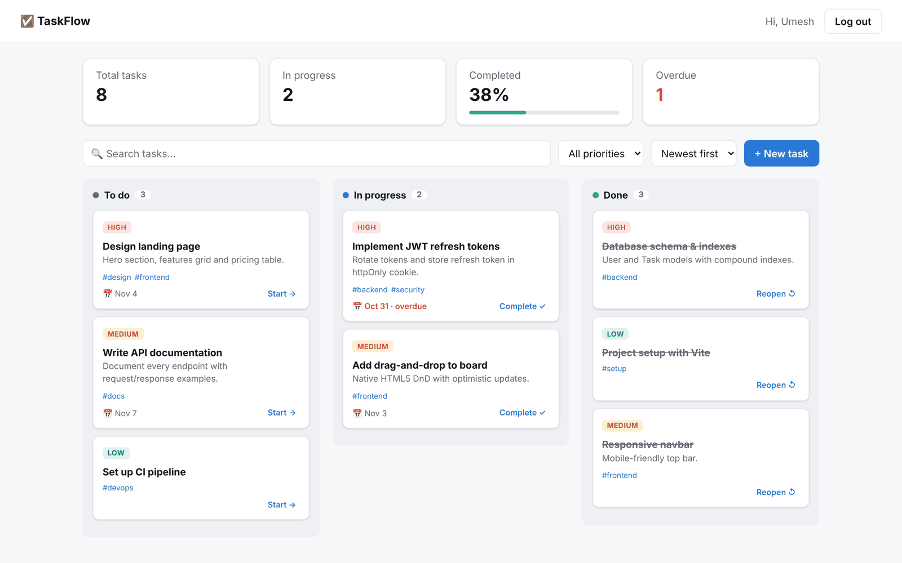
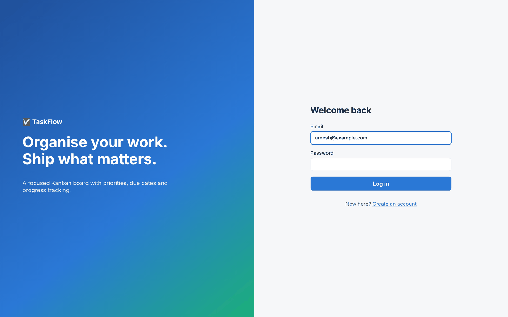
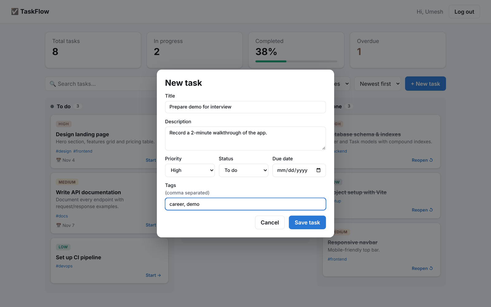
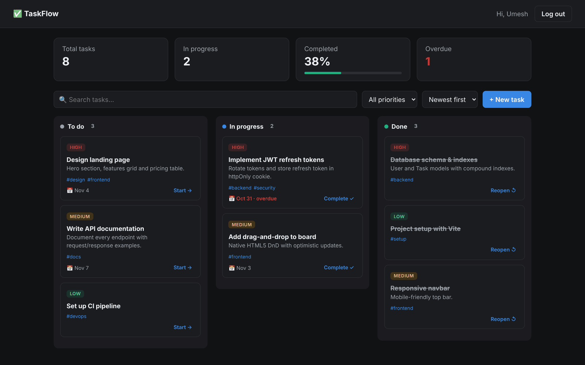

<div align="center">

# ✅ TaskFlow

### A full-stack Kanban task manager built with the MERN stack


[](https://YOUR-TASKFLOW-APP.vercel.app)



</div>

---

## ✨ Overview

**TaskFlow** is a production-style task management app. Users sign up, log in securely with **JWT authentication**, and manage their work on a **drag-and-drop Kanban board** with priorities, due dates, tags, search, filtering and live progress stats. The backend follows a clean **MVC architecture** with centralised error handling, security middleware and an integration test suite.

## 🚀 Features

**Frontend (React + Vite)**
- 🔐 Register / login with persistent sessions and protected routes
- 🗂️ Kanban board — **drag and drop** tasks between *To do*, *In progress* and *Done*
- ⚡ Optimistic UI updates for instant feedback
- 🔎 Debounced search, priority filter and 4 sort modes
- 📊 Stats bar: total, in-progress, completion %, overdue count
- 🏷️ Tags, due dates with overdue highlighting, priority badges
- 🌗 Automatic dark mode and fully responsive layout

**Backend (Node + Express + MongoDB)**
- 🔑 JWT auth with bcrypt password hashing (12 salt rounds)
- 🛡️ Security: Helmet headers, CORS whitelist, rate limiting, body-size limit, mass-assignment protection
- 👤 Strict per-user data isolation — users can never read or edit another user's tasks
- 📄 Pagination, filtering, regex-safe search, priority-aware sorting via aggregation
- 📈 `/stats` endpoint using MongoDB aggregation
- 🧯 Centralised error handler (validation, cast, duplicate-key errors → clean JSON)
- 🧪 11 integration tests with Jest, Supertest and an in-memory MongoDB

## 📸 Screenshots

| Login | Create / edit task | Dark mode |
|:---:|:---:|:---:|
|  |  |  |

## 🏗️ Architecture

```
┌──────────────────────┐    REST + JWT    ┌───────────────────────────────────────┐      ┌───────────┐
│  React (Vite)         │ ───────────────▶ │  Express API                           │ ───▶ │  MongoDB  │
│  AuthContext · Router │ ◀─────────────── │  routes → middleware → controllers     │ ◀─── │ (Mongoose)│
└──────────────────────┘      JSON        │  helmet · cors · rate-limit · errors   │      └───────────┘
                                           └───────────────────────────────────────┘
```

## 📁 Project Structure

```
taskflow/
├── server/
│   ├── src/
│   │   ├── app.js                 # Express app & middleware
│   │   ├── index.js               # Entry point
│   │   ├── config/db.js
│   │   ├── models/                # User, Task (Mongoose schemas)
│   │   ├── controllers/           # authController, taskController
│   │   ├── routes/                # authRoutes, taskRoutes
│   │   ├── middleware/            # JWT protect, error handler
│   │   └── utils/http.js          # HttpError, asyncHandler
│   └── tests/api.test.js
└── client/
    └── src/
        ├── api.js                 # fetch wrapper with JWT
        ├── context/AuthContext.jsx
        ├── pages/                 # AuthPage, Dashboard
        └── components/            # TaskCard, TaskModal, ProtectedRoute
```

## 🔌 API Reference

| Method | Endpoint | Auth | Description |
|--------|----------|:----:|-------------|
| `POST` | `/api/auth/register` | ❌ | Create account → returns token |
| `POST` | `/api/auth/login` | ❌ | Log in → returns token |
| `GET` | `/api/auth/me` | ✅ | Current user |
| `GET` | `/api/tasks` | ✅ | List tasks · `?status=&priority=&search=&sort=newest\|oldest\|due\|priority&page=&limit=` |
| `GET` | `/api/tasks/stats` | ✅ | Counts by status, overdue, completion rate |
| `POST` | `/api/tasks` | ✅ | Create task |
| `GET` | `/api/tasks/:id` | ✅ | Get one task |
| `PATCH` | `/api/tasks/:id` | ✅ | Update task |
| `DELETE` | `/api/tasks/:id` | ✅ | Delete task |

## ⚡ Getting Started

**Prerequisites:** Node.js 18+ and MongoDB (local install or a free [MongoDB Atlas](https://www.mongodb.com/atlas) cluster).

```bash
git clone https://github.com/umeshgoingtohieng/taskflow.git
cd taskflow

# Backend
cd server
cp .env.example .env        # set MONGO_URI and JWT_SECRET
npm install
npm run dev                 # http://localhost:5000

# Frontend (new terminal)
cd client
npm install
npm run dev                 # http://localhost:5173
```

The Vite dev server proxies `/api` to the backend, so no CORS setup is needed in development.

## 🧪 Tests

```bash
cd server
npm test
```

Tests spin up a throw-away in-memory MongoDB (downloaded automatically on first run), so no database setup is required.

## 🛣️ Roadmap

- [ ] Subtasks and checklists
- [ ] Team workspaces with shared boards
- [ ] Email reminders for due tasks
- [ ] Docker Compose setup and CI with GitHub Actions
- [ ] Deploy: Render (API) + Vercel (client)

## 📜 License

[MIT](LICENSE)

---

<div align="center">Made with ❤️ by <a href="https://github.com/umeshgoingtohieng">Umesh Meena</a> · ⭐ Star if you like it!</div>
